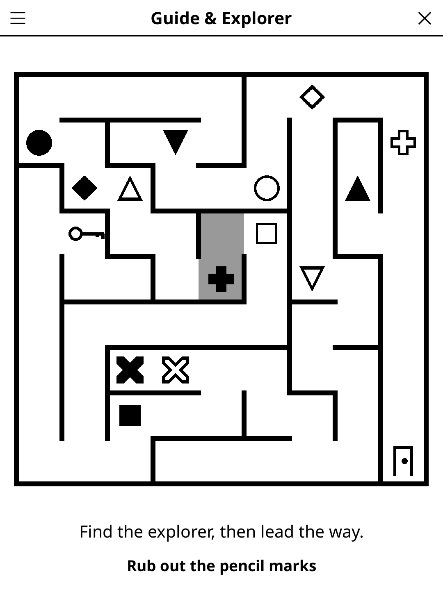

# mazeguide.koplugin

**Guide & Explorer** (*Le guide et l'explorateur*) is a cooperative maze game
for [KOReader](https://github.com/koreader/koreader), played by two people
with a reader each. The guide has the map; the explorer is lost inside and
sees only the cells around them. Talk your way to the key, then to the door.

## How to play

1. One player opens **New game → Start a game** and reads the five-digit
   code aloud; the other opens **New game → Join a game** and types it. One
   is the guide, the other the explorer.
2. The guide does not know where the explorer starts. The explorer describes
   what they see: walls, landmarks ("a black triangle two cells to my
   east"), the grey rock at the edge of the maze.
3. The guide finds them on the map (tap cells to pencil a guess) and gives
   directions. North is at the top of both screens.
4. The explorer walks with the arrows or by tapping a cell next to them,
   picks up the key, and goes out through the door.

## Features

- **No connection needed** — both readers build the same maze from the
  code, and the code's check digit refuses a typo.
- **Three levels**, set by the player who starts: Easy 7×7 (the explorer
  sees two cells around), Medium 9×9 and Hard 11×11 (one cell around).
  Mazes have loops, so there is more than one way.
- **Landmarks** — fourteen symbols on the floor, each used once per maze.
- **Score** — the explorer's steps against the shortest possible way.
- **Auto-save**; **Show the game code** reads it again.
- French, Spanish and German translations.

## Why e-ink friendly?

One step, one repaint of the explorer's small window; the guide's map only
changes when a pencil mark is added.

## License

GPL-3.0
